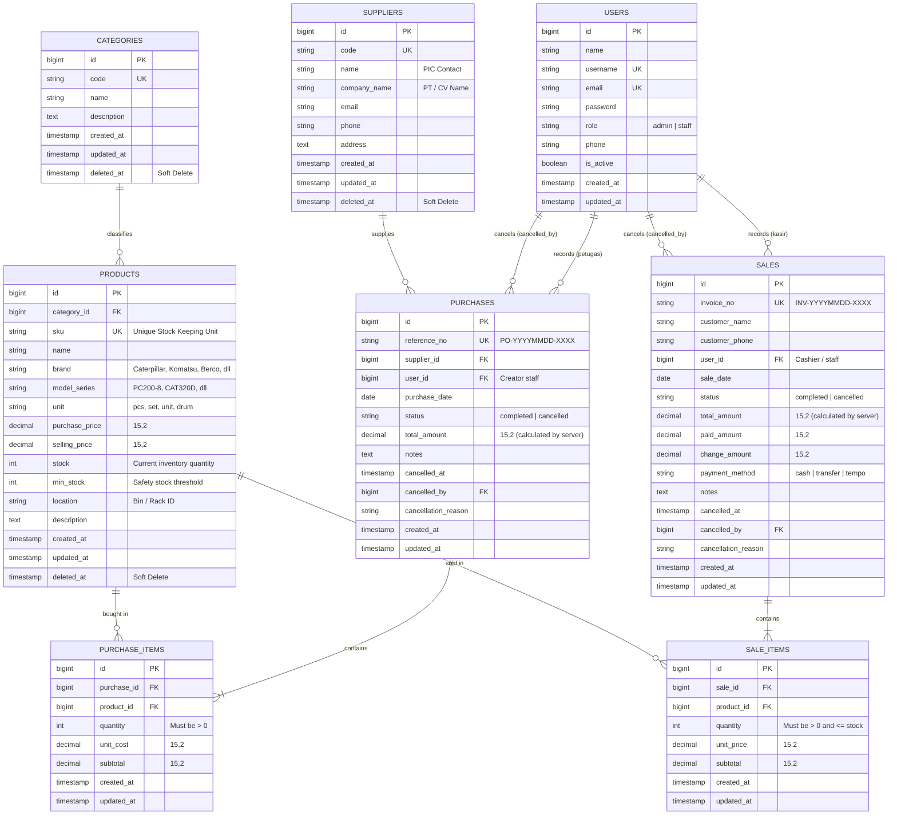

# Entity Relationship Diagram (ERD)
## Heavy Equipment Inventory & Sales Management System

Dokumen ini menjelaskan rancangan relasi basis data (database schema & constraints) pada sistem manajemen inventaris dan penjualan distributor alat berat.

---

### Penjelasan Integritas & Kardinalitas Data:

1. **`users`**:
   - Berperan sebagai otentikasi dan otorisasi (`role`: `admin` atau `staff`).
   - Berelasi ke `purchases` dan `sales` sebagai pencatat transaksi (audit trail) maupun pembatal transaksi (`cancelled_by`).

2. **`categories` -> `products` (1 to Many)**:
   - Pengelompokan jenis suku cadang alat berat (Undercarriage, Hidrolik, Mesin Diesel, G.E.T, Elektrikal).
   - Menggunakan `nullOnDelete()` dan `SoftDeletes` untuk menjamin histori data produk tidak rusak bila kategori diarsipkan.

3. **`suppliers` -> `purchases` (1 to Many)**:
   - Mencatat mitra pemasok resmi suku cadang alat berat. Dilindungi `restrictOnDelete()` sehingga supplier yang memiliki catatan PO tidak dapat dihapus sembarangan.

4. **`purchases` & `purchase_items` (Header - Detail)**:
   - Relasi 1 to Many cascade delete dari header ke item.
   - Menggunakan `lockForUpdate()` dan `DB::transaction()`: saat pembelian sukses disimpan, kuantitas bertambah otomatis ke kolom `products.stock`.

5. **`sales` & `sale_items` (Header - Detail)**:
   - Relasi 1 to Many cascade delete dari header ke item.
   - Menggunakan `lockForUpdate()` dan `DB::transaction()`: sistem memverifikasi bahwa total kuantitas tidak melebihi sisa fisik di `products.stock`. Jika stok tidak mencukupi, operasi dibatalkan total (`rollback`).

6. **Aturan Pembatalan Transaksi (Cancellation & Restocking)**:
   - Pembatalan transaksi hanya diizinkan untuk akun role `admin`.
   - Pembatalan penjualan mengembalikan kuantitas barang ke `products.stock`.
   - Pembatalan pembelian memeriksa apakah stok fisik masih mencukupi untuk dikurangi kembali ke posisi sebelum barang masuk.
