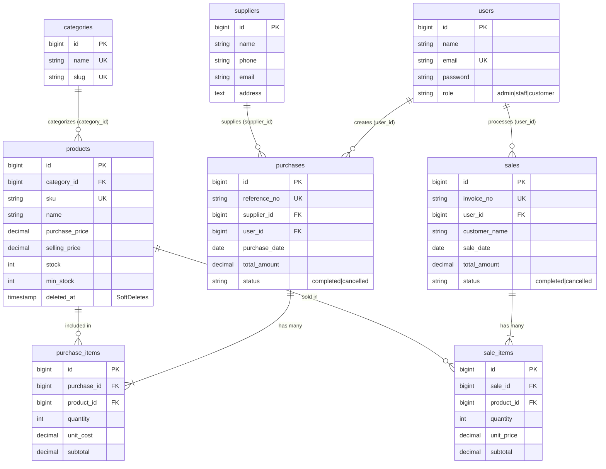

# MotoParts Pro - Motorcycle Spare Parts Sales & Inventory Management System (Laravel 10)

Sistem Informasi Manajemen Inventaris dan Transaksi Penjualan Suku Cadang Sepeda Motor (*motorcycle spare parts*) terintegrasi, dibangun menggunakan **Laravel 10**, **MySQL / MariaDB**, **Eloquent ORM**, serta dilengkapi galeri visual gambar produk, kontrol stok otomatis, kasir transaksi, dan validasi data atomic.

---

## 🚀 Fitur Utama & Kesesuaian Kebutuhan

1. **Authentication & Role-Based Access Control (RBAC)**:
   - **Admin / Owner Bengkel & Toko**: Akses penuh ke seluruh modul, manajemen akun pengguna, pembatalan transaksi dengan pemulihan stok otomatis.
   - **Staff (Kasir & Gudang Sparepart)**: Input kulakan stok (*stock-in*), kasir penjualan (*stock-out*), registrasi suku cadang beserta upload gambar, peringatan stok kritis.
   - **Pelanggan Bengkel & Retail (Customer)**: Melihat etalase katalog suku cadang motor lengkap dengan gambar, spesifikasi motor yang kompatibel, dan riwayat faktur pesanan.

2. **Master Data Suku Cadang Sepeda Motor & Gambar Visual**:
   - Master Produk Suku Cadang (SKU, Nama Sparepart, Merek OEM/Racing: AHM, YGP, Daytona, RCB, Motul, dsb., Kompatibilitas Motor: Beat, Vario 160, NMAX, Aerox, Scoopy, PCX, CBR150R, Satuan, Harga Beli, Harga Jual, Stok Aktual, Batas Minimum Stok, Lokasi Rak Toko/Gudang).
   - **Upload & Pratinjau Gambar Produk**: Setiap sparepart memiliki foto visual yang dapat diunggah atau menggunakan ilustrasi grafis SVG bawaan di direktori `public/images/products/`.
   - Master Kategori Suku Cadang (Transmisi CVT, Pengereman, Mesin & Piston, Oli & Pelumas, Kelistrikan & Aki, Suspensi, Rantai & Ban).
   - Master Distributor Resmi Suku Cadang Motor (AHM Parts Depot, Yamaha YGP Center, Daytona Racing, dsb).
   - Dilindungi *Soft Deletes* dan validasi penghapusan: produk dengan riwayat transaksi tidak dapat di-*hard delete*.

3. **Logika Transaksi Kasir & Pembaruan Stok Otomatis (*Atomic Transactions*)**:
   - **Kulakan Stok (*Purchase / Stock-In*)**: Multi-item dari supplier distributor motor, nomor PO otomatis (`PO-YYYYMMDD-XXXX`), stok bertambah otomatis hanya setelah database transaction berhasil di-*commit*.
   - **Kasir Penjualan (*Sales / Stock-Out*)**: Multi-item, pengecekan ketersediaan stok fisik secara *real-time* di server (`lockForUpdate`). Transaksi ditolak secara tegas apabila kuantitas melebihi stok. Stok berkurang otomatis setelah nota terbit.
   - **Pembatalan Transaksi**: Admin berwenang membatalkan transaksi yang keliru dengan alasan pembatalan. Stok otomatis dipulihkan/dikembalikan secara akurat.

4. **Dashboard & Laporan Agregat**:
   - Omset penjualan harian dan bulanan langsung dari agregasi database (`sum()`, `count()`).
   - Valuasi total nilai aset suku cadang di etalase & gudang bengkel (`SUM(stock * purchase_price)`).
   - Notifikasi & tabel khusus **Peringatan Stok Suku Cadang Kritis** (*Safety Stock Alert*).
   - Pencarian real-time berdasarkan SKU, nama sparepart, merek atau model motor.

---

## 🛠️ Persyaratan Sistem & Arsitektur

- **PHP**: Versi 8.2 atau lebih baru (dengan ekstensi `pdo_mysql`, `mbstring`, `openssl`, `curl`, `zip`, `fileinfo`)
- **DBMS**: MySQL 5.7+ / MariaDB 10.1+
- **Composer**: Versi 2.x
- **Framework**: Laravel 10.x
- **Arsitektur**:
  - `routes/web.php`: Routing HTTP dengan pemisahan middleware `guest`, `auth`, `role:admin,staff`.
  - `app/Http/Controllers/`: Logika bisnis terisolasi (`ProductController` menangani upload gambar, `PurchaseController`, `SaleController`, dsb).
  - `app/Models/`: Model Eloquent dengan method helper `imageUrl()` dan relasi database lengkap.
  - `public/images/products/`: Aset visual suku cadang sepeda motor (CVT, Brake Pad, Piston Kit, Aki MF, Oli 4T, Shockbreaker, Gear Set, Ban).

---

## 📥 Panduan Instalasi & Menjalankan Aplikasi

### 1. Konfigurasi Lingkungan (`.env`) & Pastikan MySQL Berjalan
- Buka **XAMPP Control Panel** lalu klik **Start** pada modul **MySQL**.
- Konfigurasi database default pada file [`.env`](file:///d:/Sistem%20Informasi/Semester%203/Pemrograman%20Web/Inventory_Sales_MS_Laravel/.env):
```ini
DB_CONNECTION=mysql
DB_HOST=127.0.0.1
DB_PORT=3306
DB_DATABASE=inventory_sales_ms
DB_USERNAME=root
DB_PASSWORD=
```

### 2. Jalankan Migrasi & Seeder Suku Cadang Motor
Jalankan perintah berikut untuk membuat seluruh tabel dan mengisi data awal suku cadang sepeda motor:
```bash
php artisan migrate:fresh --seed
```

### 3. Buat Symlink Storage (Jika Belum Terhubung)
```bash
php artisan storage:link
```

### 4. Jalankan Server Lokal
```bash
php artisan serve
```
Aplikasi dapat diakses melalui browser pada alamat: **`http://127.0.0.1:8000`**

---

## 🔑 Kredensial Akun Pengguna Bawaan (Default Seeders)

| Role | Username | Password | Keterangan |
| :--- | :--- | :--- | :--- |
| **Admin / Owner Toko** | `admin` | `admin123` | Akses penuh, manajemen user, pembatalan transaksi |
| **Kasir & Staff Gudang** | `staff1` | `staff123` | Transaksi kulakan, kasir penjualan, katalog suku cadang |
| **Mekanik / Frontdesk** | `staff2` | `staff123` | Transaksi pembelian dan penjualan sparepart |
| **Pelanggan Bengkel Motor** | `customer1` | `customer123` | Bengkel Motor Berkah Jaya (pembelian rutin) |
| **Komunitas Motor** | `customer2` | `customer123` | Komunitas Matic Speed Club |

---

## 🧪 Pengujian Otomatis (*Automated Feature Testing*)

Telah disediakan suite pengujian otomatis (`InventorySalesBusinessRulesTest`) yang menguji integritas seluruh aturan bisnis utama:
- Pengalihan otentikasi (guest redirect).
- Hak akses staff vs admin (RBAC 403 authorization).
- Penambahan stok otomatis saat pembelian sukses.
- Pengurangan stok otomatis saat penjualan kasir berhasil.
- Penolakan transaksi penjualan jika stok tidak mencukupi (rollback).
- Pembatalan transaksi dan pemulihan stok kembali ke gudang oleh Admin.

Jalankan test suite dengan perintah:
```bash
php artisan test --filter=InventorySalesBusinessRulesTest
```

---

## 📊 Diagram Relasi Database (ERD) & Relasi Eloquent

Sistem menggunakan relasi database relasional yang terintegrasi penuh dengan foreign key constraints dan cascading/restricting rules:



### Penjelasan Relasi Eloquent (Eloquent Relationships)
- `Category` **hasMany** `Product` & `Product` **belongsTo** `Category` (Kategori mengelompokkan banyak produk).
- `Supplier` **hasMany** `Purchase` & `Purchase` **belongsTo** `Supplier` (Satu pemasok dapat memiliki banyak riwayat faktur pembelian).
- `Purchase` **hasMany** `PurchaseItem` & `PurchaseItem` **belongsTo** `Purchase` (Faktur pembelian terdiri dari beberapa rincian item produk).
- `PurchaseItem` **belongsTo** `Product` & `Product` **hasMany** `PurchaseItem`.
- `User` **hasMany** `Sale` & `Sale` **belongsTo** `User` (Mencatat staf kasir yang melayani transaksi).
- `Sale` **hasMany** `SaleItem` & `SaleItem` **belongsTo** `Sale` (Faktur penjualan memiliki rincian produk yang dibeli).
- `SaleItem` **belongsTo** `Product` & `Product` **hasMany** `SaleItem`.
- *Eager Loading*: Menggunakan `Product::with('category')->paginate(10)` dan `Sale::with(['user', 'items.product'])` guna menghindari masalah query duplikat (**N+1 Problem**).

---

## 🚫 Batasan Sistem (*Known Limitations*)

Berdasarkan batasan ruang lingkup proyek UTS pada panduan teknis:
1. **Payment Gateway**: Belum terintegrasi dengan Payment Gateway pihak ketiga (Midtrans/Xendit) — transaksi menggunakan pencatatan tunai (*cash*), transfer langsung, atau nota tempo.
2. **Multi-Warehouse**: Sistem dirancang untuk inventaris satu cabang / satu gudang utama (*single warehouse*).
3. **Mata Uang**: Hanya mendukung mata uang tunggal Rupiah (IDR).
4. **Akuntansi Lanjutan**: Laporan berfokus pada pergerakan stok, omset penjualan, modal kulakan, dan valuasi aset; belum mencakup pembukuan jurnal umum neraca/laba-rugi ganda (*double-entry bookkeeping*).
5. **Aplikasi Mobile**: Berbasis *Web Responsive Layout* dan belum memiliki aplikasi mobile native Android/iOS terpisah.

---

## 📸 Dokumentasi & Antarmuka Utama

Aplikasi menyediakan halaman-halaman antarmuka yang bersih dan responsif:
- **Dashboard Ringkas**: Menampilkan metrik total produk, akumulasi transaksi, total omset penjualan, valuasi aset, serta tabel peringatan suku cadang stok rendah (*low stock alert*).
- **Master Data (Kategori, Produk, Supplier)**: Manajemen data terproteksi dengan pencarian real-time, filter kategori, validasi server-side, serta pencegahan hard-delete produk bertransaksi.
- **Transaksi Kulakan (*Purchases*)**: Input multi-item dinamis dengan penomoran PO otomatis dan penambahan stok seketika.
- **Kasir Penjualan (*Sales / POS*)**: Input multi-item dinamis, validasi stok instan di server dengan `lockForUpdate`, perhitungan subtotal otomatis, dan cetak struk/nota.
- **Manajemen Akun & Log Pembatalan**: Admin dapat membatalkan transaksi yang keliru disertai alasan pembatalan dengan pemulihan stok otomatis.

---

## 📁 Struktur Direktori Visual Produk

```
public/
└── images/
    └── products/
        ├── placeholder.svg     # Gambar default jika produk belum memiliki foto
        ├── vbelt_cvt.svg       # Ilustrasi V-Belt & Roller CVT
        ├── brake_pad.svg       # Ilustrasi Kampas & Disc Brake
        ├── piston_kit.svg      # Ilustrasi Piston Kit & Ring Seher
        ├── oli_mesin.svg       # Ilustrasi Botol Oli Mesin Motul/AHM
        ├── aki_motor.svg       # Ilustrasi Aki Kering Maintenance Free
        ├── shockbreaker.svg    # Ilustrasi Shockbreaker Tabung RCB
        ├── gear_set.svg        # Ilustrasi Sprocket Gear & Rantai SSS Gold
        ├── ban_motor.svg       # Ilustrasi Ban Tubeless Soft Compound
        └── lampu_led.svg       # Ilustrasi Lampu Depan Biled Projector
```

